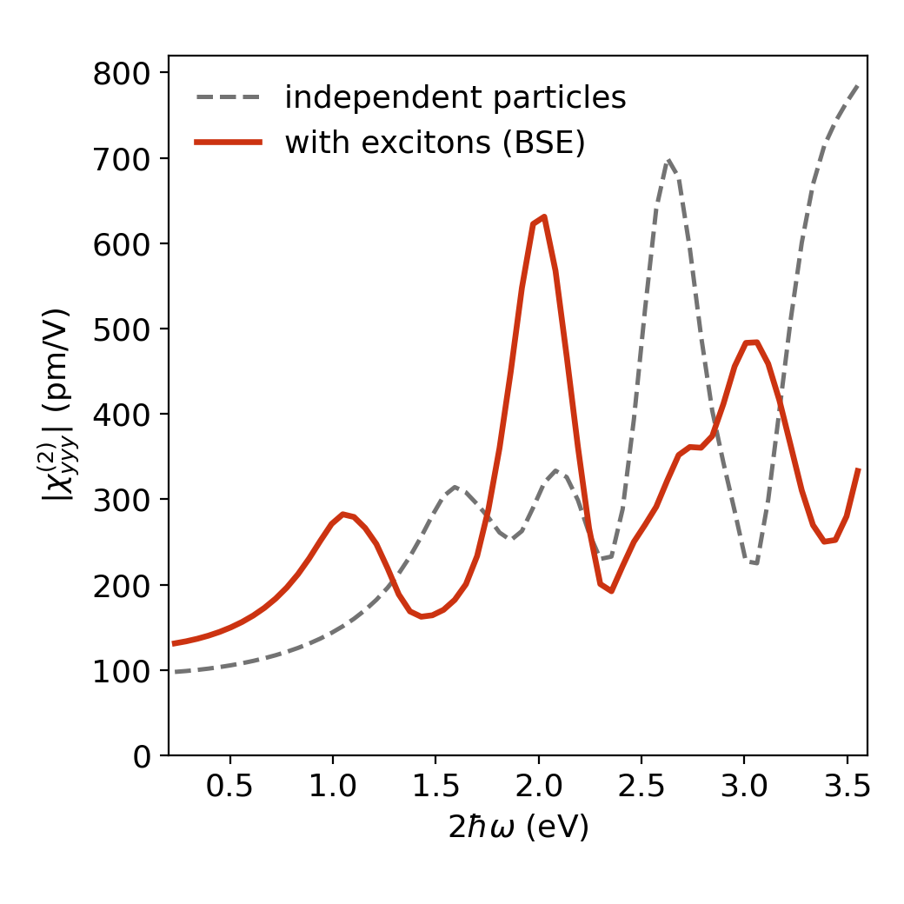

# exshg

**Second-harmonic generation with excitons from ELK Bethe–Salpeter calculations.**

`exshg` is a post-processing tool for the all-electron code [ELK](https://elk.sourceforge.io).
ELK computes the second-order susceptibility χ⁽²⁾(2ω; ω, ω) for independent particles
(task 125) and linear optical spectra with excitons from the Bethe–Salpeter equation (BSE,
tasks 185–187), but it has no second-order response with excitons. `exshg` combines the
two: it reads the momentum matrix elements and the BSE eigenvectors of a finished ELK run
and returns χ⁽²⁾ with the electron–hole interaction included at the second-harmonic
frequency.

No change to the ELK source is needed.

## Method

The independent-particle response is obtained from the length-gauge density matrix to
second order (Aversa and Sipe, 1995), with z = ω + iη:

```
ρ1^b_nm(z)    = − f_nm r^b_nm / (ω_nm − z)
S^bc_nm(z)    =   [r^c, ρ1^b]_nm + i (ρ1^b_nm);c
ρ2^bc_nm(2z)  =   S^bc_nm / (ω_nm − 2z)
χ^abc(2z)     =   (i / 2z) (1/Ω) Σ_k w_k Tr( v^a ρ2^bc )
```

On the BSE transition space (k, v, c), the independent-particle propagator of the
second-harmonic step, 1/(ω_cv − 2z), is replaced by the Tamm–Dancoff exciton propagator
built from the BSE eigenvalues Ω_S and eigenvectors X_S:

```
ρ2_cv = Σ_S X_S (X_S† S_cv) / ( Ω_S − 2z)
ρ2_vc = Σ_S X_S* (X_S^T S_vc) / (−Ω_S − 2z)
```

Transitions outside the BSE window keep their independent-particle form, so the result
reduces to the independent-particle χ⁽²⁾ when the electron–hole kernel is switched off.

### Built-in check

The same substitution at first order must reproduce the dielectric function that ELK
itself writes (`EPSILON_BSE_ab.OUT`). Every run prints the correlation and the median
ratio between the two. For a correct run both are 1.0000. If they are not, do not trust
the second-order result.

### Approximations

- Excitons enter only at 2ω (two-photon resonances with excitons). The first-order step
  at ω is independent-particle, and transitions between excitons are not included.
- Tamm–Dancoff approximation, as in the ELK BSE.
- The optional scissor shift is rigid: it moves all energy denominators and the exciton
  energies, and leaves the matrix elements and the electron–hole kernel unchanged.
- Like any BSE calculation, the result is limited by the k-mesh and the band window of
  the underlying BSE run.

## Installation

```bash
git clone https://github.com/yucj-520/exshg.git
cd exshg
pip install .
```

The only dependency is NumPy (Matplotlib for the example plot).

## Usage

1. Run ELK with the ground state, the momentum matrix elements and the BSE:

   ```
   tasks
     0
     120
     121
     180
     185
     186
     187

   scissor
     0.0

   reducek
     0
   ```

   `reducek 0` is required (the BSE and `PMAT.OUT` must use the same full k-grid), and the
   ELK run must have `scissor 0`. The blocks `swidth`, `wplot`, `nvbse` and `ncbse` are read
   from `elk.in`.

2. Run `exshg` on the directory of that run:

   ```bash
   exshg path/to/elk_run 222            # χ_yyy
   exshg path/to/elk_run 222 --scissor 0.02646 --txt
   ```

   | Option | Meaning |
   |---|---|
   | `abc` | Cartesian component, e.g. `222` = yyy (default) |
   | `--scissor D` | consistent scissor shift in Hartree |
   | `--wmax E` | largest fundamental photon energy in eV (default 1.8) |
   | `--every n` | use every n-th point of the ELK `wplot` grid (default 4) |
   | `--out prefix` | output prefix |
   | `--txt` | also write a text table in eV and pm/V |

   The same calculation is available from Python:

   ```python
   from exshg import excitonic_shg
   res = excitonic_shg("path/to/elk_run", "222")
   ```

### Output

`XSHG_BSE_<abc>.npz` contains

| Key | Content |
|---|---|
| `w` | fundamental frequency ω (Hartree) |
| `chi_ip` | independent-particle χ⁽²⁾ (atomic units, retarded) |
| `chi_x` | χ⁽²⁾ with excitons |
| `contrib` | resonant contribution of each exciton to `chi_x`, shape (excitons, ω) |
| `Om` | exciton energies (Hartree) |
| `eps_x`, `eps_elk` | dielectric function rebuilt here and the one written by ELK |
| `linear_corr`, `linear_ratio` | result of the built-in check |

Multiply by `exshg.AU_PMV` (24.44) for pm/V. The susceptibility is normalised to the
unit-cell volume. For a two-dimensional material in a supercell, multiply by
(cell height)/(layer thickness) to obtain the value for a film of that thickness.
ELK writes the advanced response, which is the complex conjugate of the retarded one
used here.

## Example

[`examples/mos2_monolayer`](examples/mos2_monolayer) contains the ELK input for
monolayer MoS₂ (PBE with spin–orbit coupling, 12 × 12 k-mesh), the reference spectrum and
a plotting script. The built-in check gives correlation 1.0000 and ratio 1.0000 for this
run, and the peaks of χ⁽²⁾ appear where 2ħω equals the energies of the A and C excitons
of the same BSE calculation.



## Validation

- The independent-particle part agrees with ELK task 125 at scissor 0 to about 1 %.
- The first-order substitution reproduces ELK's `EPSILON_BSE` (see the built-in check).
- For monolayer MoS₂ without spin–orbit coupling on a 21 × 21 k-mesh with a scissor of
  0.72 eV, the main peak is at ħω = 1.45 eV with 530 pm/V (thickness 6.15 Å). The
  real-time calculation of Grüning and Attaccalite gives 1.56 eV and about 650 pm/V. Their
  method also includes the excitons at ω.

## Limitations

- Tested with ELK 11.2.3 built with gfortran. `EVBSE.OUT` is read as a gfortran sequential
  unformatted file, including records larger than 2 GiB.
- The BSE eigenvectors are held in memory: 16 N² bytes for N = n_k × n_v × n_c transitions.
- One tensor component per run.

## References

- C. Aversa and J. E. Sipe, Phys. Rev. B **52**, 14636 (1995).
- M. Grüning and C. Attaccalite, Phys. Rev. B **89**, 081102(R) (2014).
- The ELK code, <https://elk.sourceforge.io>.

## Citation

If you use `exshg`, please cite this repository. A publication describing the method and
its first application is in preparation.

## Licence and author

GPL-3.0-or-later. Written by Cuiju Yu (Aalto University). Parts of the code were developed
with the assistance of an AI coding tool (Claude) and validated against ELK as described
above.
