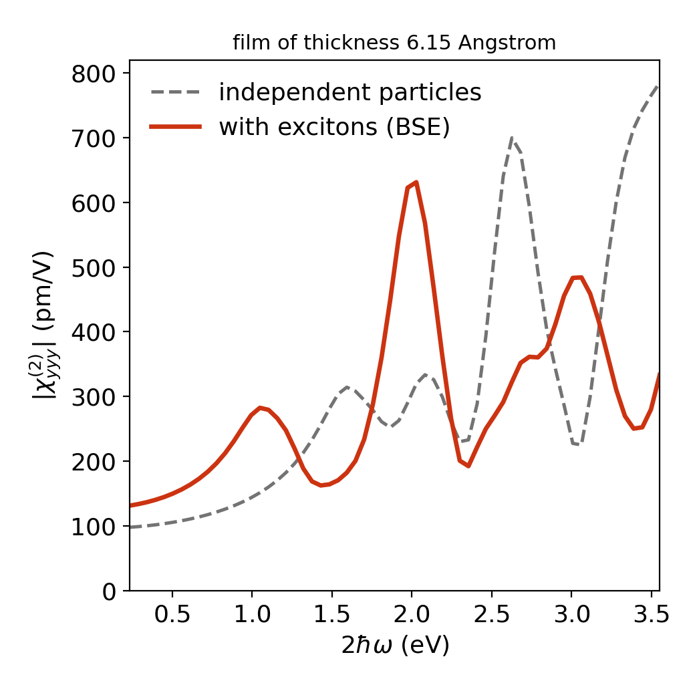

# exshg

**Second-harmonic generation with excitons from ELK Bethe–Salpeter calculations**

`exshg` computes the second-order optical susceptibility χ⁽²⁾(2ω; ω, ω) of a crystal
including excitons. It is a post-processing tool for the all-electron code
[ELK](https://elk.sourceforge.io): it reads the output of a finished Bethe–Salpeter (BSE)
run and returns the second-harmonic spectrum with and without the electron–hole
interaction. ELK itself is used unchanged.



## Quick start

```bash
pip install git+https://github.com/yucj-520/exshg.git
exshg path/to/elk_bse_run 222 --plot
```

The first line installs the tool. The second line computes χ_yyy from the ELK run in the
given directory and writes a table (`.txt`), the full data (`.npz`) and a figure (`.png`).

## Contents

| Page | Content |
|---|---|
| [Installation](install.md) | `pip install`, requirements, ELK |
| [Tutorial: monolayer MoS₂](tutorial.md) | the full workflow, step by step, with the expected output |
| [Example: MoS₂/WSe₂ tetralayer](tetralayer.md) | a 12-atom heterostructure with spin–orbit coupling |
| [Method](method.md) | equations, approximations and the built-in check |
| [Reference](reference.md) | command line, Python function, output files, units, troubleshooting |

## Source code, questions, citation

- Source code and examples: <https://github.com/yucj-520/exshg>
- Questions and bug reports: <https://github.com/yucj-520/exshg/issues>
- If you use `exshg`, please cite the repository
  ([`CITATION.cff`](https://github.com/yucj-520/exshg/blob/main/CITATION.cff)).
