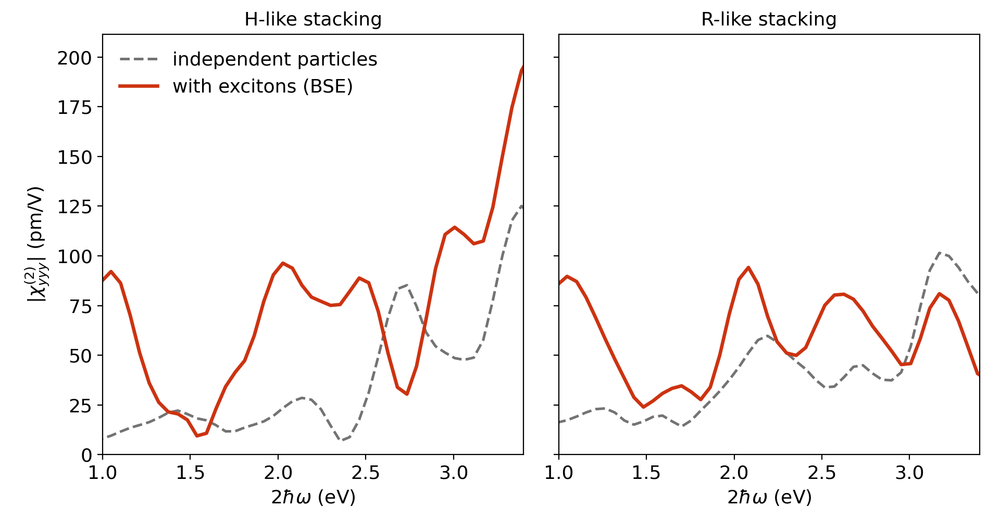

# Example: MoS₂/WSe₂ tetralayer

A van der Waals heterostructure of bilayer WSe₂ on bilayer MoS₂ (12 atoms per cell) in
two stackings, H-like and R-like. This is the size of system for which `exshg` was
written: spin–orbit coupling, no symmetry, and a BSE with 9216 transitions. All files are
in
[`examples/mos2_wse2_tetralayer`](https://github.com/yucj-520/exshg/tree/main/examples/mos2_wse2_tetralayer).

| Folder or file | Content |
|---|---|
| `H-like/elk.in` | ELK input, H-like stacking |
| `R-like/elk.in` | ELK input, R-like stacking |
| `reference/H-like/`, `reference/R-like/` | reference table and figure of each stacking |
| `plot.py`, `tetralayer_shg.png` | script and figure that show both stackings side by side |

## Settings

| Quantity | Value |
|---|---|
| Structure | relaxed 1 × 1 cell, a = 3.23 Å, cell height 40 Å |
| Functional | PBE with spin–orbit coupling |
| k-mesh | 6 × 6 × 1, Γ-centred |
| BSE | Tamm–Dancoff, 16 valence and 16 conduction bands, 9216 transitions |
| Broadening | `swidth` 0.003 Ha (0.08 eV) |
| Scissor | none |
| Film thickness for the normalisation | 27 Å |

## Steps

For each stacking (`H-like`, `R-like`):

```bash
cd H-like
# set sppath in elk.in to your ELK species directory
mpirun -np 40 elk > elk.out          # ground state, PMAT.OUT, BSE
exshg . 222 --thickness 27 --plot
cd ..
```

and then, for the figure with both stackings,

```bash
python plot.py H-like/XSHG_BSE_222.txt R-like/XSHG_BSE_222.txt my_result.png
```

The built-in check of `exshg` should report

```
H-like:  correlation 1.0000, amplitude ratio 0.9956: passed
R-like:  correlation 1.0000, amplitude ratio 0.9939: passed
```

## Result



Values for a film of thickness 27 Å, as printed by `plot.py`:

| Stacking | Mean of the absolute value of χ_yyy for 2ħω = 1.8–2.25 eV, independent particles | Same, with excitons | Maximum with excitons in this range |
|---|---|---|---|
| H-like | 21.6 pm/V | 78.5 pm/V | 96.3 pm/V at 2.03 eV |
| R-like | 43.1 pm/V | 64.1 pm/V | 94.2 pm/V at 2.08 eV |

## Resources

| Step | Resources |
|---|---|
| ELK (ground state, `PMAT.OUT`, BSE), per stacking | about 9 hours on 80 cores |
| `exshg`, per stacking | 3 minutes on 20 cores, 8 GB of memory |

## Notes

- The reference runs started the self-consistent cycle from a converged density
  (`task 1`). The inputs given here start from scratch (`task 0`). Differences in the last
  digits are expected.
- The energies are PBE energies without a quasiparticle correction.
