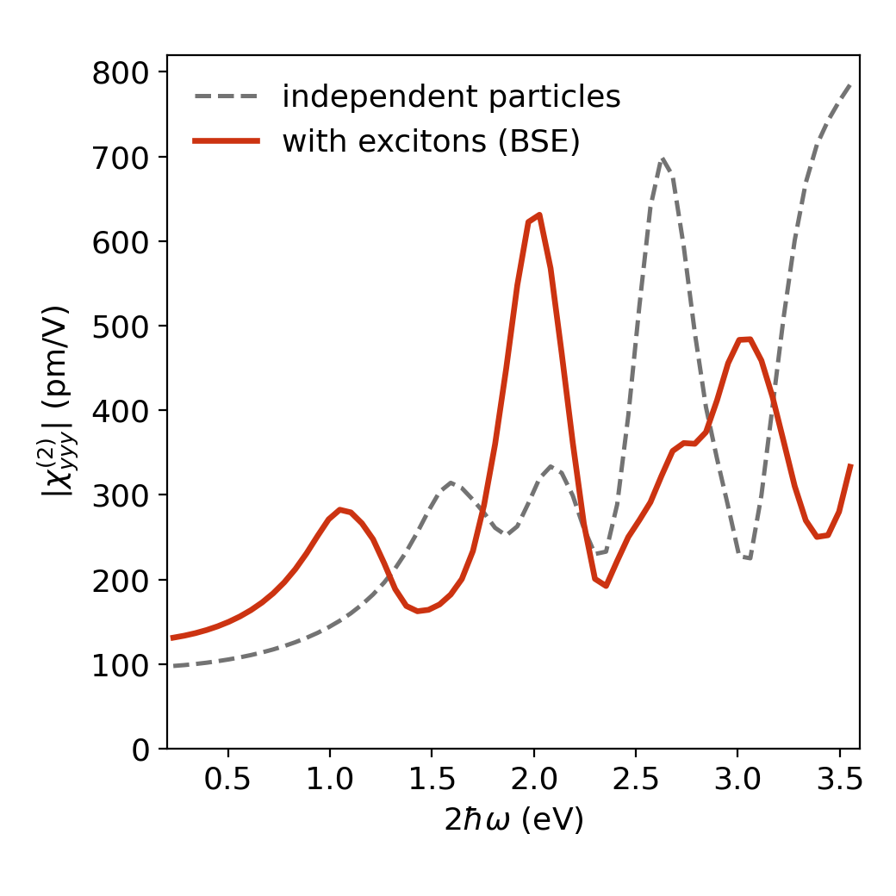

# Tutorial: monolayer MoS₂

[Back to contents](index.md)

This tutorial runs the complete workflow for χ⁽²⁾_yyy of free-standing monolayer MoS₂ and
compares the result with the reference shipped in the repository. All files are in
[`examples/mos2_monolayer`](https://github.com/yucj-520/exshg/tree/main/examples/mos2_monolayer).

You need a working ELK 11.2.3 (see [Installation](install.md)). The ELK part takes about
half an hour on 40 cores.

## Step 1. Get the example

```bash
git clone https://github.com/yucj-520/exshg.git
pip install "./exshg[plot]"
cd exshg/examples/mos2_monolayer
```

## Step 2. Set the species path

Open `elk.in` and replace the path in the `sppath` block by the `species` directory of
your ELK copy (keep the trailing slash):

```
sppath
  '/path/to/elk/species/'
```

Nothing else needs to be changed. The input asks ELK for

| Task | What it does | File used by `exshg` |
|---|---|---|
| `0` | ground state (PBE with spin–orbit coupling) | `EIGVAL.OUT`, `KPOINTS.OUT`, `INFO.OUT`, `LATTICE.OUT` |
| `120` | momentum matrix elements | `PMAT.OUT` |
| `121` | independent-particle dielectric function | |
| `180` | screened interaction for the BSE | |
| `185` | BSE Hamiltonian | |
| `186` | BSE eigenvalues and eigenvectors | `EVBSE.OUT` |
| `187` | BSE dielectric function | `EPSILON_BSE_22.OUT` |

## Step 3. Run ELK

```bash
export OMP_NUM_THREADS=2
mpirun -np 20 elk > elk.out
```

(or simply `elk > elk.out` for an OpenMP-only build). On a cluster, put these lines in a
job script. The run is finished when `EPSILON_BSE_22.OUT` exists.

## Step 4. Run exshg

```bash
exshg . 222 --txt
```

The last lines of the output should be

```
  linear check Im eps_22 vs ELK EPSILON_BSE: corr 1.0000, median ratio 1.0000
  BSE-space resonant share of IP chi_222 (|.| at max): 0.870
  wrote XSHG_BSE_222.npz
  wrote XSHG_BSE_222.txt
```

The first line is the built-in check: `exshg` rebuilds the BSE dielectric function of ELK
from the same files and compares. A correlation of 1.0000 means that the files were read
correctly.

## Step 5. Plot and compare

```bash
python plot.py XSHG_BSE_222.txt my_result.png
```

Compare `my_result.png` with the reference figure `mos2_shg.png`:



and your table with `reference/XSHG_BSE_222.txt`. The peaks of the curve with excitons are
at 2ħω = 1.05, 2.03, 2.73 and 3.06 eV. The first two are the two-photon resonances with
the A exciton (1.07 eV) and the C exciton (2.01 eV) of the same BSE run
(`EIGVAL_BSE.OUT`). Small differences in the last digits between machines are normal.

## Notes

- The calculation uses PBE energies without a quasiparticle correction and a 12 × 12
  k-mesh. It tests the workflow; it is not a converged prediction for MoS₂.
- By symmetry, χ_xxx vanishes for this orientation. `exshg . 111` gives a curve about 2 %
  of χ_yyy, which is the size of the symmetry breaking of the ELK BSE itself on this mesh.
- For your own material, start from this input, replace `avec` and `atoms`, and choose
  `ngridk`, `nvbse`, `ncbse` and `nempty`. Keep `reducek 0` and `scissor 0.0`.
