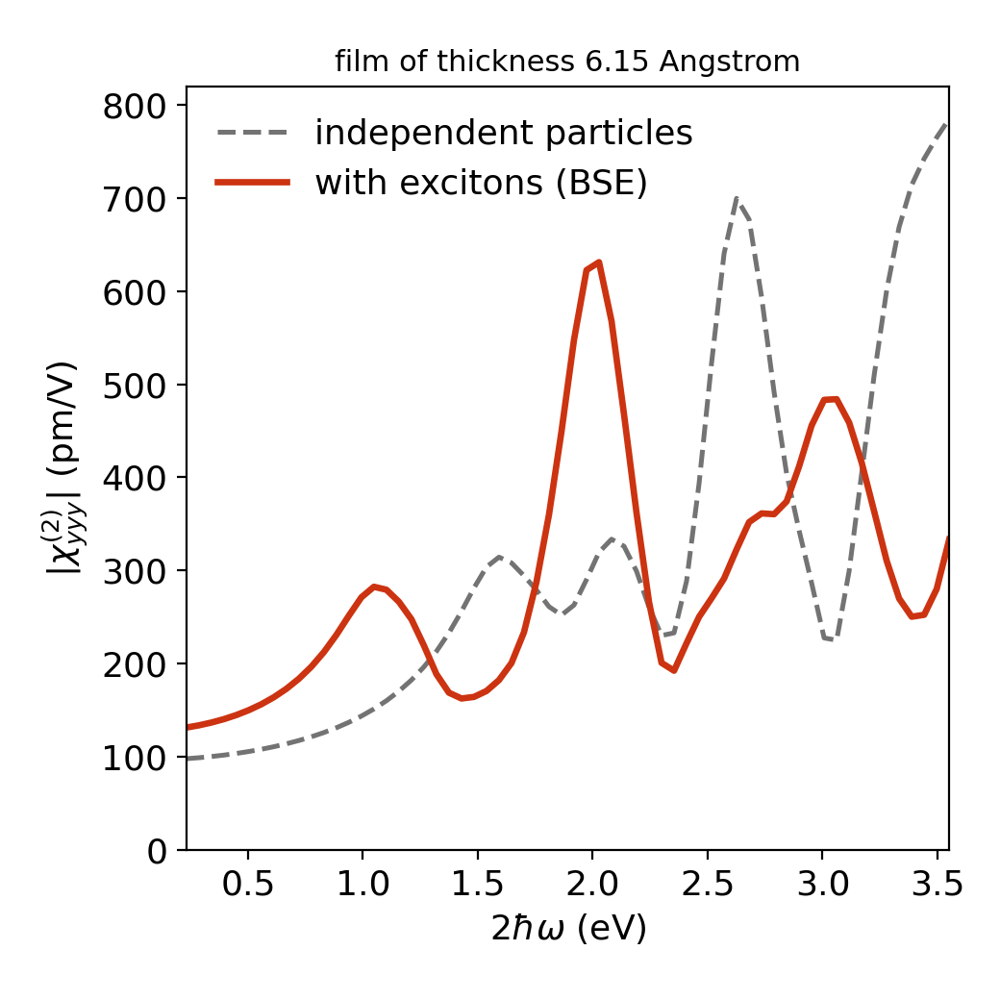

# Monolayer MoS₂

ELK input and reference result for χ⁽²⁾_yyy of free-standing monolayer MoS₂
(PBE with spin–orbit coupling, 12 × 12 k-mesh, 4 valence and 4 conduction bands in the BSE).

```bash
# set sppath in elk.in to your ELK species directory
mpirun -np 20 elk > elk.out
exshg . 222 --thickness 6.15 --plot
```

| File | Content |
|---|---|
| `elk.in` | ELK input |
| `reference/XSHG_BSE_222.txt` | reference table written by the command above |
| `reference/XSHG_BSE_222.png` | reference figure written by the command above |



The step-by-step description with the expected screen output is in the
[tutorial](https://yucj-520.github.io/exshg/tutorial.html).
