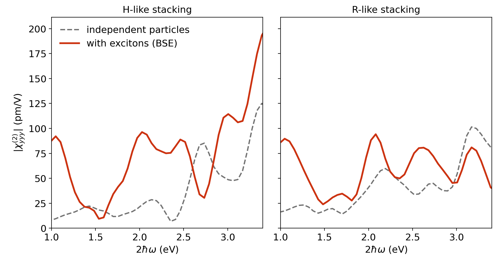

# MoS₂/WSe₂ tetralayer

ELK inputs and reference results for χ⁽²⁾_yyy of a van der Waals heterostructure of
bilayer WSe₂ on bilayer MoS₂ (12 atoms, PBE with spin–orbit coupling, 6 × 6 k-mesh,
16 valence and 16 conduction bands in the BSE), in H-like and R-like stacking.

```bash
cd H-like                            # then the same in R-like
# set sppath in elk.in to your ELK species directory
mpirun -np 40 elk > elk.out
exshg . 222 --txt
cd ..
python plot.py H-like/XSHG_BSE_222.txt R-like/XSHG_BSE_222.txt my_result.png
```

Reference results (`reference/`, figure `tetralayer_shg.png`), for a film of thickness 27 Å:

| Stacking | Mean for 2ħω = 1.8–2.25 eV, independent particles | same, with excitons | Maximum with excitons in this range |
|---|---|---|---|
| H-like | 21.6 pm/V | 78.5 pm/V | 96.3 pm/V at 2.03 eV |
| R-like | 43.1 pm/V | 64.1 pm/V | 94.2 pm/V at 2.08 eV |



The full description, the expected output and the computational cost are in the
[documentation](../../docs/tetralayer.md).
